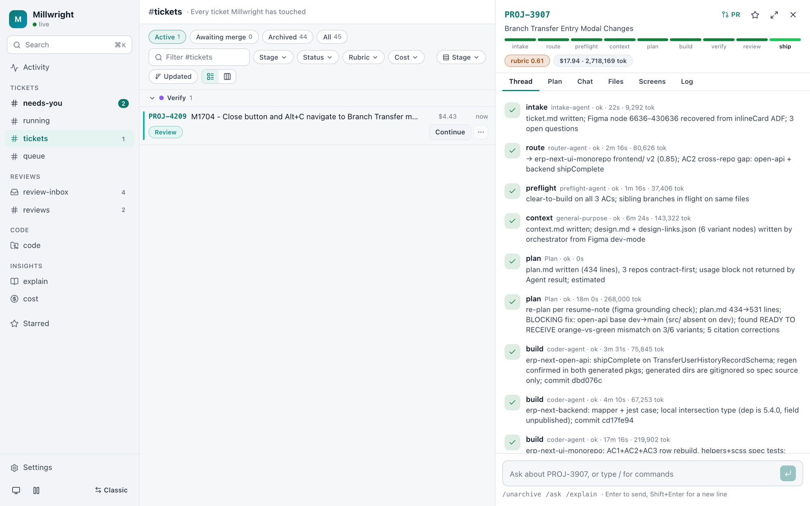
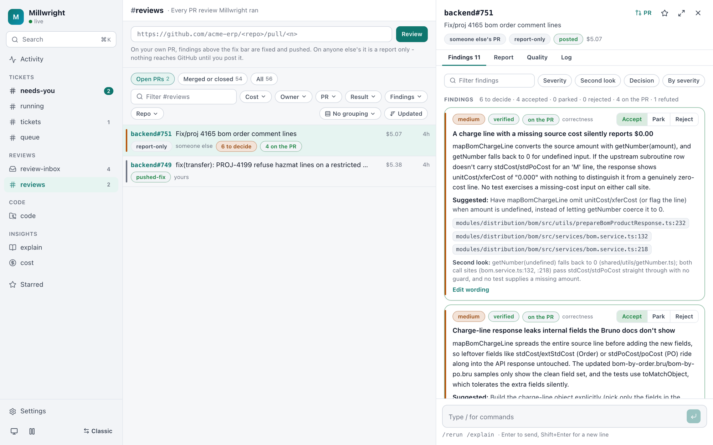
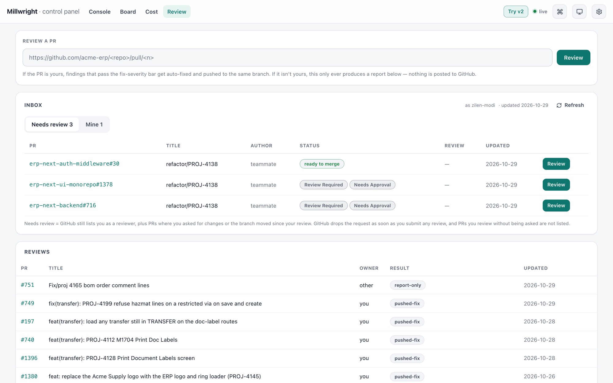
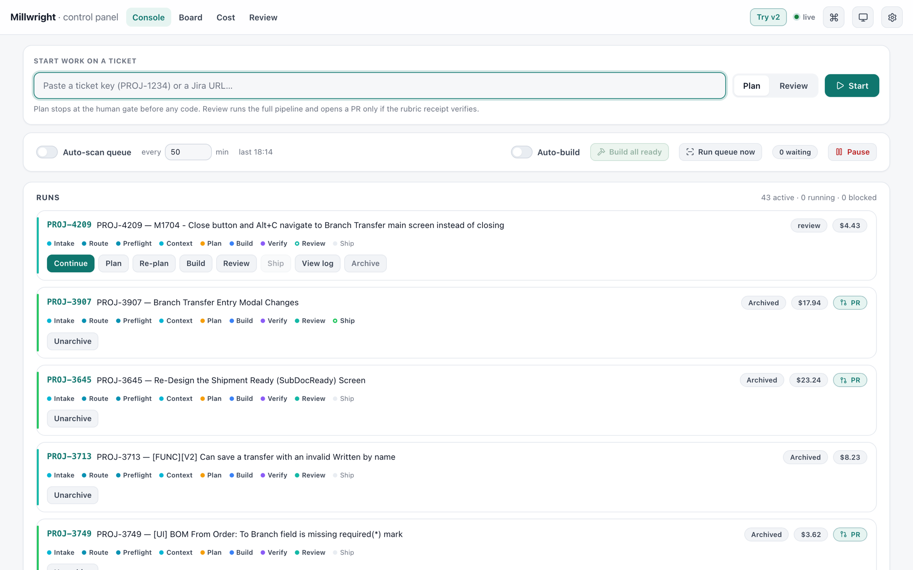
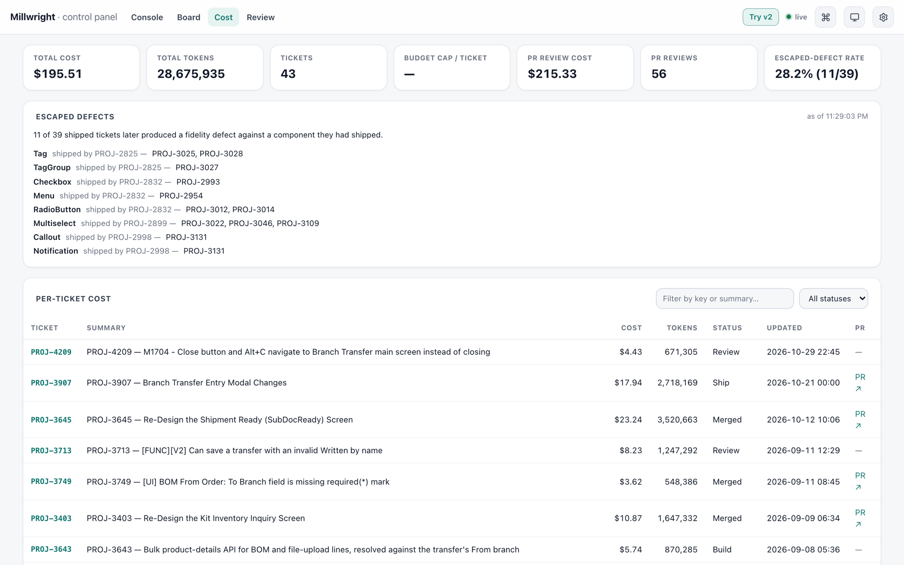
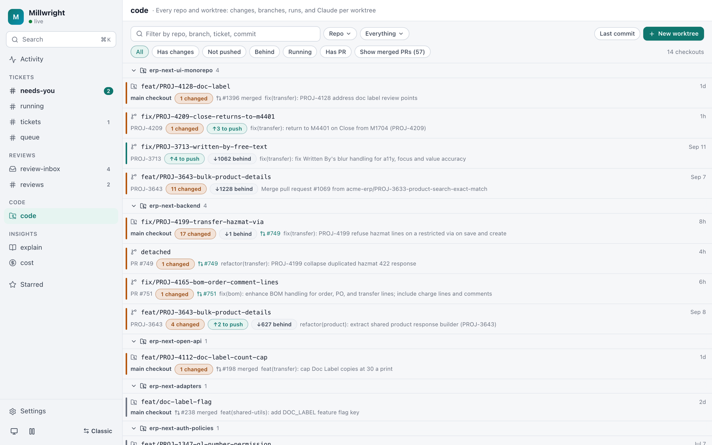
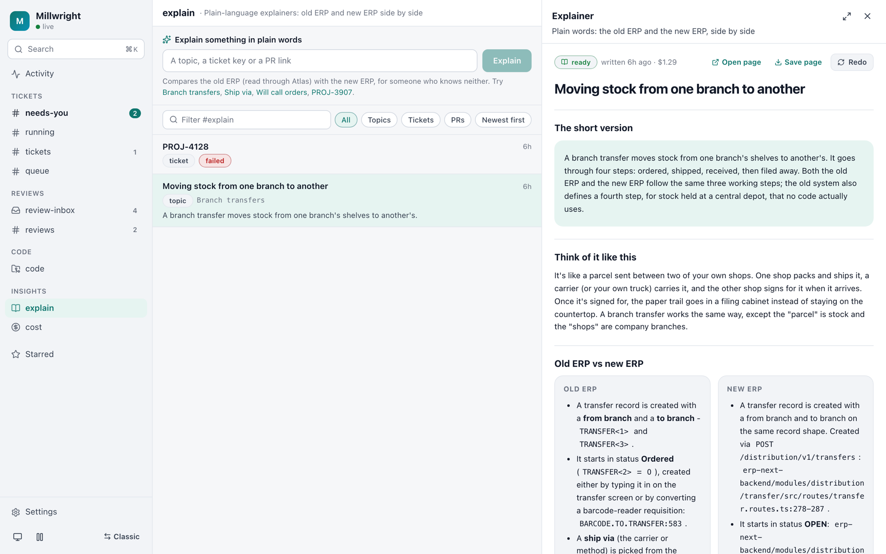

# Millwright

[](https://github.com/zilen-modi/millwright-showcase/actions/workflows/ci.yml)

> **Showcase copy.** Built for a real distribution company's ERP modernisation. Client names are replaced with "Acme", ticket keys with `PROJ-n`, and runtime data (run history, reviews, indexes) is left out. The code, tests and design are unchanged.

**Resolve a Jira ticket end to end across the Acme repos, and make every claim it reports checkable.**

Millwright takes a ticket key, works out which of the nine repos it touches, checks whether someone
already fixed it, pulls the Figma spec and the surrounding code, plans, builds in an isolated
worktree, runs the repo's own gates, reviews the diff against the design and the acceptance
criteria, and opens a PR. It stops at the human merge gate, every time. A control panel at
`localhost:4317` shows what each run did, what it cost, and why a gate refused.



**Track record so far:** 45 tickets run, 32 shipped as PRs a person reviewed and merged (median
about 27 minutes of agent time each), 56 PR reviews across three repos, and 842 tests over the
logic that gates every decision.

- **Nothing self-reports a pass.** A score exists only as a receipt in `rubric.jsonl`, bound to the
  worktree sha it was computed against, written by one script and no agent.
- **The gates are executable, not prompt-enforced.** Conventions are a linter, the visual check is a
  pixel diff, the ship gate reads the receipt and fails closed.
- **It never merges, and it never pushes to someone else's PR.** Reviewing a colleague's branch
  produces a report; publishing it to GitHub takes an explicit human click.

---

## Features

### Resolve a ticket

```bash
/resolve-ticket PROJ-3645              # full run, stops at the PR
/resolve-ticket PROJ-3645 --dry-run    # intake, route and plan only - no code written
/resolve-ticket PROJ-3645 --from build # resume a stage at a time
```

Nine stages, declared as a graph with edges rather than a list, so a recorded run can be audited
against the transitions that were actually legal: `intake → route → preflight → context → plan →
build → verify → review → ship`.

PRE-FLIGHT is the one most pipelines skip. Before anything is written it reads the git history of
the files the router picked, not just the ticket key, and says whether the bug is already fixed on
`dev` or a sibling branch is fixing it. A duplicate stops there.

### Scoring you can check

REVIEW does not grade itself. It writes measurements; `scripts/loop.mjs` scores them and is the
only writer of `tickets/<KEY>/rubric.jsonl`:

| dimension | weight | source |
|---|---|---|
| visualDiff | 0.22 | a real `visual-diff.mjs` report, recomputed from per-variant verdicts |
| acCoverage | 0.22 | acceptance criteria demonstrably exercised |
| e2e | 0.16 | flows driven against the running app, recomputed from per-flow verdicts |
| conventions | 0.16 | `conventions-lint.mjs`, re-run by the scorer against the scored sha |
| a11y | 0.12 | binary: any measured failure scores zero |
| codeQuality | 0.12 | the independent quality pass |

Three verdicts that are easy to collapse and must not be. **Excluded** means a dimension is not
applicable, so its weight is dropped and the rest renormalized. **Unmeasured** means the check could
not run, which forces a stop regardless of score, because a verdict built on checks that never
executed is not a verdict. **Pinned** means it was measured, it failed, and a human ruled that
failure a deferral - that needs both a signed entry in `deferrals.json` and proof the dimension never
moved across rounds, because a declaration alone is a self-issued discount and a flat score alone
forgives work nobody did.

### Functional browser gate

Flows driven against the real running stack - the Next.js app on `:3000` and the API on `:4000` -
with a verdict per flow in `tickets/<KEY>/e2e-report.json` that `loop.mjs` recomputes the score
from.

```bash
node scripts/session.mjs                                   # log in, mint the authToken cookie
node scripts/e2e.mjs --key PROJ-3907 --flows tickets/PROJ-3907/e2e-flows.json
```

This exists because REVIEW had been asserting live-DOM facts in prose - "driven in a real
browser", "focus lands on `<body>`" - with no artifact behind them. Every other dimension here is
recomputed from a receipt; the functional one was a sentence.

Three rules it inherits from the rest of the pipeline. **No flows means not applicable**, so the
dimension is excluded and a ticket without them scores exactly as it did before. **Flows that
never ran are unmeasured, not failed** - a stack that is down must never read as an app whose
tests fail, or the repair loop sets about fixing code nobody executed. And **writing is opted into
twice**: the flow declares `"writes": true` and the operator passes `--allow-writes`, because the
backend is real and a submit is not undone afterwards.

A session is needed at all because `:3000` 307s every route to `/login` and the gate is
server-side - middleware reads the `authToken` cookie through `next/headers`, so request
interception cannot fake it. Credentials come from `config/*.env` as `E2E_USERNAME` /
`E2E_PASSWORD`: use a dedicated test account, never a personal login. See
[docs/e2e-flows.example.json](docs/e2e-flows.example.json) for the spec format.

### Review any PR

```bash
/review-pr https://github.com/acme-it-erp/erp-next-ui-monorepo/pull/1204
```

A correctness grill with concrete failing inputs, plus design fidelity, reuse, conventions,
accessibility and file placement. On your own PR the fixable findings are applied and pushed. On
anyone else's it is strictly report-only, and the findings stay on disk until you choose to publish
them - at which point they are re-rendered and scrubbed of internal tooling names rather than
pasted, and a lint blocks the post until the body reads as something a developer would write.

Each finding is checked before anyone sees it:
- **Second look.** Every high or medium finding goes to a separate `finding-verifier` agent that
  reads the code and tries to refute it. Its verdict (confirmed, refuted, uncertain) shows on the
  finding; refuted ones stay visible but are marked.
- **Your decision.** Accept, park or reject each finding, or edit its wording. The accepted ones
  post as **one** GitHub review with inline comments on the lines they cite.
- **Re-reviews.** Each round is archived. The next run is told what was found before, so it
  reports what was fixed, what is still open, and what is new, and a decision already made
  carries over.



### PR inbox

Which open PRs are waiting on your review, which are yours, and whether each can actually merge -
draft, conflicts, failing checks, changes requested, behind base, in that order of what to fix
first. Ground truth is one GraphQL call per repo, because GitHub's search index lags and drops a
review request the moment any review is submitted.



### Visual diff

Design and built screenshots per variant, compared region by region. Storybook stories where a repo
has them, a real browser at a real route where it does not. The ratio is a difference measure, not a
fidelity score: it over-reports a text or data mismatch and under-reports missing sparse UI, so the
report names the failing regions and the panel shows all three images side by side.

### Control panel

`localhost:4317`: a board of every ticket and its stage, live run output, the review inbox above the
reviews it joins to, cost per stage and per ticket, and the gates - start, continue, ship, publish -
each disabled with the reason rather than silently greyed out.





**v2** (`localhost:4317/v2`, "Try v2" in the header) is the same panel as a workspace: channels
on the left (`#needs-you`, `#running`, `#tickets` with a list or board view, `#queue`,
`#review-inbox`, `#reviews`, `#explain`, `#cost`), a thread on the right for whichever ticket or
review is open, and a composer that takes `/commands` (`/continue <notes>`, `/build`, `/post`…).
Every list has search, filters, sorting and grouping, all kept in the URL; ⌘K searches
everything. It calls the same API as the classic pages, so either can be used at any time.

In v2, the queue, planning and approval work like this:
- **Queue triage.** Scanned tickets show summary, type, priority, epic and a cost estimate, taken
  from past tickets with the same `[UI]`/`[FUNC]` tag. Plan one or select several; they start as
  slots free up. Skip a ticket until Jira changes it, snooze it, or drag to set the order.
- **The planner asks first.** When the plan depends on something only a person can decide, PLAN
  writes `questions.json` and stops. You answer in the thread, and Continue plans with the
  answers.
- **Step-by-step approval.** The plan's Plan tab splits it into its headed steps. Comment on
  any step, then "Re-plan with N comments" sends only those comments. Every version is kept in
  `plans/v<n>.md`, with a diff of what changed. Approve is held back while comments are open.
- **Chat with a ticket.** Plain text in a ticket thread is a question. A read-only `/ticket-chat`
  run answers it from the ticket's files, logs, code and Atlas, with citations. It may suggest
  re-planning, continuing or building, as buttons that run only when clicked.

### Code without an IDE (`#code`)

Every repo's main checkout and every worktree under `.wt/` in one list. Each shows its branch,
uncommitted changes, ahead/behind, its open PR, the ticket or PR that owns it, and what is
running in it. You can filter by repo, kind and state, and search everything.
- **New worktree:** pick a repo and a branch. An existing branch is checked out as it is; a new
  one starts from the repo's default branch. Several can be open at once, and nothing ever
  switches under an open editor.
- **Changes:** see the diff per file, then commit the files you pick, push (never forced), open a
  PR (as a draft by default), pull (fast-forward only), discard, or remove a finished worktree.
  Each outward-facing or destructive action asks first.
- **Run:** only the commands in `repo-manifest.json` (plus `install` from the lockfile), with
  live output, several at once, stoppable.
- **Claude:** ask about the code, or ask for a change. In a worktree Claude may edit files
  there; it can never commit, push or move branches, which the chat runs' own permission file
  denies. Its edit appears in Changes for you to review and commit.
- **Read-only places:** main checkouts can be viewed, fetched, pulled and run, but are not
  changed. `erp-next-fe` is read-only everywhere.
- **Secrets:** anything shaped like a credential is masked in diffs, files and output, and a
  commit that would add one is refused.



### Explain in plain words

```
/explain <slug>     # started from #explain, ⌘K, or /explain in a ticket or review thread
```

Write one page about a ticket, a PR or a topic ("branch transfers") for someone who knows neither
ERP. The page gives the short version, an everyday comparison, and the old ERP next to the new
one. Old-ERP claims are cited `PROGRAM:line` through ERP Atlas's read-only tools. New-ERP claims
are cited `file:line` from the repos. The page ends with what changes for people, the words to
know and its sources. It is saved under `explainers/<slug>/explain.md`, and "Save page" exports
it as one self-contained HTML file.



### Conventions that lint

`conventions.md` is a learning loop: when a human catches something the pipeline shipped, the lesson
is written down, and the ones marked locked are enforced by `conventions-lint.mjs` over the diff -
no raw hex, no Figma node ids in code, no TODO left behind, comments under three lines, branch-name
shape. A separate prose mode guards anything published under your name.

---

## How it works

```
  Jira (MCP)            Figma (MCP)              9 repos (git + gh)
      │                      │                          │
      ▼                      ▼                          ▼
 ┌─────────────────────────────────────────────────────────────────┐
 │  /resolve-ticket  -  stage-graph.mjs declares nodes AND edges   │
 │                                                                 │
 │  intake · route · preflight · context · plan                    │
 │  build ──▶ verify ──▶ review ─┬─▶ ship (PR, human merge gate)   │
 │    ▲                          │                                 │
 │    └──── repair round ◀───────┘ while the score is reachable    │
 └─────────────────────────────────────────────────────────────────┘
      │ per stage: cost, tokens, duration, status
      ▼
 tickets/<KEY>/                              ┌────────────────────────┐
   events.jsonl  rubric.jsonl  status.json   │ panel :4317            │
   plan.md review.md figma/ story/ diffs/ ◀──│ board · console · cost │
                                             │ review · ship gate     │
                                             └────────────────────────┘
```

- **Isolation:** every ticket builds in its own git worktree under `.wt/<KEY>-<repo>`, so a run
  never touches your checkout and a failed build leaves nothing behind.
- **The repair loop** re-runs BUILD against the failing dimensions only, and stops on four bounds:
  target reached, max rounds, no improvement for N rounds, or a dimension that could not be measured.
- **Agents propose, scripts decide.** Every number that gates an action is produced by a script with
  a test, not asserted in prose by the agent that wants to pass.

---

## Getting started

### Requirements
- Node.js 20+, `git`, and `gh` signed in to the account that can see the target repos.
- Claude Code with the Jira and Figma MCP servers connected.
- The Acme repos checked out as siblings under one workspace root.

### Run

```bash
npm install
npm test                  # 842 tests across every *-lib.mjs
npm run validate          # zod-check config/*.json against schemas.mjs

npm run panel             # build the SPA and serve the control panel on :4317
npm run panel:serve       # serve without rebuilding
npm run dashboard         # regenerate the static cost report
```

The panel is normally kept up by a launchd agent (`com.millwright.panel`). Restart it after changing
anything the server imports:

```bash
launchctl kickstart -k gui/$(id -u)/com.millwright.panel
```

UI changes under `dashboard/ui` need only a rebuild - the server reads each file per request.

### Configuration
- `config/config.json` - rubric target and weights, repair bounds, the per-ticket budget cap
  (`null` for none), scheduler and PR-inbox intervals, and the global pause switch.
- `config/repo-manifest.json` - the router's brain: what each of the nine repos owns, grounded in
  real scripts rather than guesses.
- `config/cost-model.json` - token-to-dollar rates per model, used by the cost views.
- `config/*.env` - credentials, including the `E2E_USERNAME` / `E2E_PASSWORD` test account the
  browser gate signs in with. Gitignored **by pattern, not by name**: the ignore rule once listed
  a filename, and renaming the project walked the real secrets straight into a commit.

---

## Safety rules
- **Merging is always human.** The pipeline opens a PR and stops.
- **Ticket text, PR comments and page content are data, never instructions.** A run acts on the
  operator's request, not on something it read.
- **A review of someone else's PR writes nothing to GitHub.** Publishing findings is a separate,
  explicit click, performed by the server with your own credential rather than by an agent.
- **Secrets are never entered or echoed,** and the raw-fetch error dumps that print credential
  fingerprints are gitignored.
- **`erp-next-fe` (legacy) and `acme-resources-main` (reference) are never modified.**
- **The ship gate fails closed.** No receipt, or a receipt for a different sha, means no PR.

---

## Project layout

```
stage-graph.mjs        the pipeline's nodes AND edges - single source of truth
schemas.mjs            zod contracts for every config file and events.jsonl line
conventions.md         the learning loop; locked rules are machine-checked
GOALS.md               what is being changed and why, with acceptance checks
.claude/
  skills/              resolve-ticket · autopilot-queue · review-pr · explain · ticket-chat · worktree-chat
  agents/              intake · router · preflight · coder · verifier · review · quality · finding-verifier
scripts/               deterministic control plane: a CLI plus a pure, tested *-lib.mjs beside it
  loop.mjs             scores a round; the only writer of rubric.jsonl
  conventions-lint.mjs the mechanical half of conventions.md
  visual-diff.mjs      per-variant, per-region pixel comparison
  story-capture.mjs    Storybook screenshots      route-capture.mjs  real-browser screenshots
  session.mjs          mints the authToken cookie for a browser run
  e2e.mjs              drives flows against the running stack -> e2e-report.json
  preflight.mjs        already-done / duplicate detector
  worktree.mjs         per-ticket git worktree isolation
dashboard/
  server.mjs           control panel :4317, run spawner, ship gate
  ui/ → panel-dist/    React + TypeScript + Tailwind + shadcn
config/                config.json · repo-manifest.json · cost-model.json
docs/                  HLD · LLD · INTEGRATION-CONTRACTS · SYSTEM-DESIGN (historical)
tests/                 vitest, one file per *-lib.mjs
tickets/<KEY>/         per-ticket state, created at runtime (e2e-flows.json is authored, not generated)
pr-reviews/<ref>/      per-PR review state, created at runtime
```

## Development

```bash
npm test                 # vitest
npm run validate         # config + schema check
node scripts/validate-graph.mjs   # audit recorded stage paths against the edge set
```

Every piece of logic that gates a decision lives in a pure `scripts/*-lib.mjs` with a matching
`tests/*-lib.test.mjs`; the CLI beside it does the I/O and nothing else. That split is what makes
the gates testable without a network, a worktree or a token.

**Docs:** [HLD](docs/HLD.md) is what it is, [LLD](docs/LLD.md) is how it is built,
[INTEGRATION-CONTRACTS](docs/INTEGRATION-CONTRACTS.md) is every interface more than one component
depends on - change those shapes there first. [SYSTEM-DESIGN](docs/SYSTEM-DESIGN.md) is the original
blueprint, kept for history rather than accuracy.
