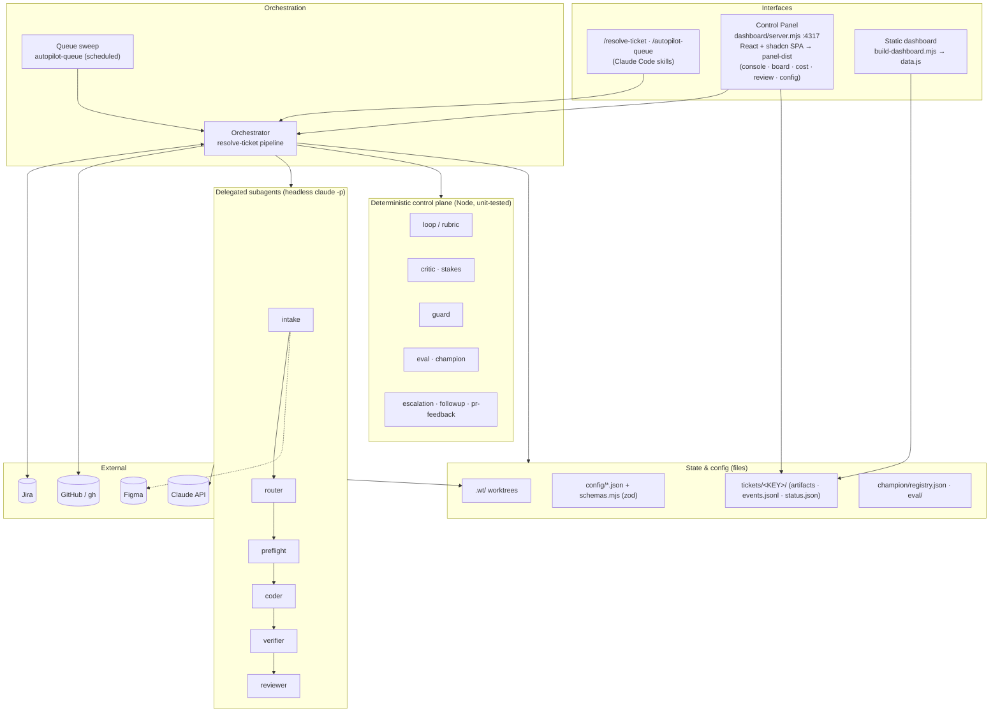

# Autopilot — High-Level Design (HLD)

> Autonomous Jira-ticket resolution across the Acme repos. Intake a ticket → route →
> plan → build → verify → review → open PR, stopping at a human merge gate.
> This HLD describes the **as-built** system; see [LLD.md](LLD.md) for module-level detail
> and [SYSTEM-DESIGN.md](SYSTEM-DESIGN.md) for the original design rationale.

---

## 1. Purpose & scope

Autopilot turns a labelled Jira ticket into a reviewed pull request with **no human in the
loop until the merge gate**. It is optimised for the Acme ERP-modernization frontend/back-end
repos (UI-kit components, API endpoints), and is **local-first**: it runs on a developer's
machine or a scheduled job, not as a hosted cloud service.

In scope: understanding a ticket, deciding which repo(s) it touches, implementing the change in
an isolated worktree, proving it with the repo's own gates (tests/lint/typecheck/build),
adversarially reviewing it, and opening a ready-for-review PR with a Jira audit trail.

Out of scope: merging (always human), production deploys, and anything not gated behind the
`autopilot` label when running unattended.

## 2. Design principles

- **Human owns the merge.** Autopilot never merges; the furthest it goes autonomously is a
  ready-for-review PR, and only when a numeric rubric clears its target.
- **Ground in code, not priors.** The routing manifest is a *first guess*; every decision is
  confirmed against a real code search before it is acted on.
- **Isolation.** Each ticket/repo builds in its own git worktree under `.wt/`; primary
  checkouts are never touched, and parallel work never collides.
- **Everything is metered.** Every stage runs as a delegated subagent that reports real token
  usage; cost is priced and surfaced, never estimated.
- **Deterministic control, model-driven work.** Loops, gates, promotion decisions, and cost
  math live in pure, unit-tested Node modules; only the creative work (planning, coding,
  reviewing) is delegated to the model.
- **A gate written in prose is not a gate.** Every quality gate is executable code that the
  orchestrator cannot satisfy by asserting it passed. Learned the hard way: across the first 25
  tickets the "mandatory" per-variant screenshot diff produced **zero** reports while the rubric
  reported ≥0.965 on nearly everything, because the gate lived in a prompt. Scores are now
  receipts bound to a tree sha, convention violations are recomputed from the diff, and any
  value a reviewer supplies for a machine-checkable field is discarded.
- **Never ask an agent for something it cannot do.** An instruction without a mechanism does not
  produce a refusal, it produces a fabrication — `review-agent` was told to screenshot a story
  while holding no browser tool, so every run either invented a number or reached for a skip
  reason. Capability and instruction are checked together.
- **Absence of evidence is not evidence.** "Not applicable" (excluded, may pass) and "the check
  could not run" (unmeasured, blocks the verdict) are distinct outcomes. Collapsing them let a
  ticket score a clean 1.000 on three of five dimensions.
- **Fail safe, resume forward.** Each completed stage is checkpointed; a crash resumes from the
  last good stage rather than restarting, and irreversible actions sit behind gates.
- **Data, not instructions.** Ticket text, comments, and design-file contents are treated as
  data. Directives found inside them are surfaced to a human, never executed.

## 3. Architecture overview

Autopilot is a set of cooperating **local components**, not networked services. The only
external dependencies are the Claude model API (via the Claude Code CLI), Jira, Figma, and
GitHub (via `gh`), all reached through MCP or CLIs.



### Component roles

| Component | Kind | Responsibility |
|---|---|---|
| **Orchestrator** (`/resolve-ticket`) | Claude Code skill | Drives the 9-stage pipeline for one ticket; owns gates, resume, and cost logging. |
| **Queue sweep** (`/autopilot-queue`) | Claude Code skill | Scans Jira for `autopilot`-labelled tickets and runs each through the pipeline unattended, bounded by `maxPerRun` and `mode`. |
| **Control Panel** (`dashboard/server.mjs`) | Node HTTP server (:4317) | Live kanban/console/cost/config UI; spawns headless `claude -p` runs, streams logs via SSE, manages the scheduled scan and global pause. |
| **Static dashboard** (`build-dashboard.mjs`) | Node build script | Aggregates per-ticket `events.jsonl` into a priced cost/history page (`data.js` + `index.html`). |
| **Subagents** | Claude Code agent types | The metered workers: `intake`, `router`, `preflight`, `coder`, `verifier`, reviewer (`story-reviewer`), plus `general-purpose` for context. |
| **Control plane** | Node modules (`scripts/*`) | Deterministic loops, gates, cost math, eval, and promotion — pure logic in `*-lib.mjs`, IO in the CLI wrappers. |
| **Config + schemas** | JSON + zod (`schemas.mjs`) | Validated runtime config, cost model, routing manifest, queue policy. |
| **State** | Files (`tickets/`, `queue-runs/`, `champion/`, `eval/`, `.wt/`) | Per-ticket artifacts + telemetry, run logs, prompt registry, eval ground truth, worktrees. |

## 4. The pipeline

One ticket flows through nine stages. Each stage is a delegated subagent that emits a
`stage_end` event with real usage; gates between stages decide auto-proceed vs. human sign-off.

```
INTAKE → ROUTE → PREFLIGHT → CONTEXT → PLAN → BUILD → VERIFY → REVIEW → SHIP
  │        │         │          │        │       │        │        │       │
 haiku   sonnet    sonnet    general    opus   sonnet   sonnet    opus   haiku
```

| Stage | Output artifact | Purpose |
|---|---|---|
| **INTAKE** | `ticket.md` | Normalize the Jira ticket (ACs, links, Figma/Confluence, parent/subtasks). |
| **ROUTE** | `route.md` | Decide repo(s) + sub-package + build order, with confidence, grounded in code search. |
| **PREFLIGHT** | `preflight.md` | Detect already-done / duplicate work from git history before building. |
| **CONTEXT** | `context.md` | Gather the specific files/design the build needs. |
| **PLAN** | `plan.md` | Step-by-step implementation plan + files to touch. |
| **BUILD** | branch + commits | Implement in an isolated worktree, plus tests. |
| **VERIFY** | `verify.md` | Run install/build/test/lint/typecheck; loop a fixer on red. |
| **REVIEW** | review notes | Adversarial self-review against ACs; repair high/medium findings. |
| **SHIP** | PR + Jira comment | Open a ready-for-review PR, post an owner-tagged audit comment, transition the ticket. |

The arrow diagram above is the happy path, not the shape. The pipeline is a **directed graph**
declared in `stage-graph.mjs` — the single source of truth for its nodes, its edges and every
projection of them (`schemas.mjs` validates against it; the panel derives its resumable set and
board columns from it). Beyond the straight line it carries a repair cycle
(`review → build → verify → review`), a fixer loop (`verify → build`), an early exit
(`preflight → done`, when the work already exists), SHIP's self-review flowing backwards
(`ship → build|verify`), and escalation reachable from every stage.

Declaring the edges made illegal transitions detectable for the first time: `scripts/validate-graph.mjs`
audits recorded history and found tickets that shipped without passing through REVIEW, and others
that skipped the mandatory CONTEXT stage.

A **repair loop** wraps BUILD→VERIFY→REVIEW, scoring each attempt against a weighted rubric
(visual-diff, AC coverage, conventions, a11y, code quality). Its verdict is one of `done`,
`continue`, or a `stop-*` escalation — including **`stop-unverified`**, which fires when a
dimension could not be measured at all and outranks even the budget and round caps, because a
verdict resting on checks that never executed is not a verdict.

## 5. Runtime & deployment model

- **On-demand** — a developer runs `/resolve-ticket PROJ-1234`, or clicks a ticket in the panel.
- **Unattended (scheduled)** — a cron-scheduled `/autopilot-queue` scans the label query and
  resolves up to `maxPerRun` tickets. Autonomy is capped by `mode`
  (`dry-run` → `build-verify-notify` → `auto-draft-pr`); the default never opens a PR.
- **Panel-managed** — `server.mjs` runs a live kanban, spawns runs as headless `claude -p`
  child processes (with a pre-scoped permission policy, since headless runs can't prompt), and
  can run its own interval scan. A global **pause** kill-switch cancels active runs and blocks new ones.

There is no server tier to deploy; the "deployment" is a Node process + the Claude Code CLI on a
machine with repo checkouts and credentials (`config/autopilot.env`).

## 6. State & data model (high level)

- **Per ticket** (`tickets/<KEY>/`): human-readable artifacts (`ticket.md`, `route.md`,
  `plan.md`, …), `status.json` (resumable stage + branches/PRs), append-only `events.jsonl`
  (metered telemetry), and `rubric.jsonl` — the **scoring receipt**.
- **The receipt is the unit of trust.** `scripts/loop.mjs` is its only writer, and each line is
  stamped with the HEAD sha of the worktree it scored, which is what binds a number to a tree.
  Nothing else may write `rubricScore` — not the orchestrator, not an agent, not by hand — and
  the panel displays a score only when a receipt backs it, surfacing anything else as
  *unverified* rather than rendering it as fact.
- **Cost model**: `events.jsonl` records real `tokensTotal` (+ optional `cacheReadTokens`);
  `cost-model.json` prices them; the dashboard aggregates cost by stage/model/ticket and a
  prompt-cache hit-rate.
- **Config**: all runtime knobs in `config/*.json`, validated by zod on load so drift fails
  early rather than producing a wrong run or dashboard.
- **Learning state**: `champion/registry.json` (versioned per-agent prompts), `eval/golden-set.json`
  (merged tickets as ground truth), `eval/rerun-cache.json` (cached eval scores).

## 7. Cross-cutting concerns

- **Safety & gates.** Config gates (`afterRoute`, `beforePR`, `merge: human-only`, …) decide
  auto vs. confirm. Unattended runs trigger only on the `autopilot` label. Merge is always human.
- **Ship gate.** The panel refuses to spawn a manual force-ship whose receipt is missing, stale,
  or bound to a different sha, answering HTTP 409 with a readable reason. It fails closed on a
  missing worktree or a failed `rev-parse`. It deliberately does **not** gate the modes that
  *run* REVIEW — those write the receipt, so gating them would deadlock the ticket that needs
  one. Their shipping decision is made afterwards against the receipt `loop.mjs` produced.
- **Escaped-defect rate.** The honest outcome metric, and the only one that measures the
  artifact rather than the reviewer's confidence: how often a shipped ticket later produced a
  fidelity defect against a component it had shipped (`scripts/regression-trace.mjs`, surfaced
  on the panel's Cost page). It exists because the rubric showed no measurable separation
  between tickets that escaped and those that didn't.
- **Cost governance.** Per-ticket USD budget in the repair loop; the dashboard shows cost by
  stage/model and per-ticket spend vs. cap.
- **Escalation.** When confidence is low or stakes are high, a stage writes an `escalation.json`,
  notifies + comments (owner-tagged), and pauses the ticket instead of proceeding.
- **Follow-up.** A sweep nudges stale open PRs and escalates older ones so nothing Autopilot
  opened goes stale.
- **Self-improvement.** A closed-ish loop: mine outcomes → propose a challenger prompt → score
  champion vs. challenger on a golden-set holdout → human-gated promotion (`champion/registry.json`).
  The eval harness supports `--mode diff` (cheap, frozen diff) and `--mode rerun` (real BUILD in a
  worktree), with a rerun cache keyed on prompt/base so unchanged reruns cost nothing.
- **Observability.** Live SSE log stream + kanban in the panel; static cost/history dashboard;
  per-ticket event timeline; queue-run logs.

## 8. Non-functional characteristics

| Property | How it's achieved |
|---|---|
| **Resumability** | Stage checkpoints in `status.json`; `--from <stage>` resume; panel "Continue". |
| **Isolation** | One git worktree per ticket/repo under `.wt/`; teardown after ship. |
| **Auditability** | Owner-tagged Jira comments, per-ticket artifacts + `events.jsonl`, queue-run logs. |
| **Bounded blast radius** | `maxPerRun`, per-ticket budget, repair-round caps, label-only trigger, human merge gate. |
| **Integrity** | Scores are sha-bound receipts written by one module; machine-checkable rubric inputs are recomputed and any supplied value discarded; recorded stage paths are validated against a declared edge set. |
| **Testability** | Deterministic control plane in pure `*-lib.mjs` with a vitest suite; a golden-set regression harness whose cases are derived from real merged diffs. |
| **Cost efficiency** | Model tiering per stage, prompt caching (instrumented), eval rerun cache. |

## 9. Key risks & mitigations

| Risk | Mitigation |
|---|---|
| Model ships wrong/plausible code | Adversarial REVIEW + repair loop + human merge gate. |
| Prompt-injection via ticket/design text | Treated as data; directives surfaced, never executed. |
| Runaway cost | Per-ticket budget, `maxPerRun`, stall detector, model tiering. |
| Self-improvement drift/reward-hacking | Holdout-validated, human-gated promotion; regression floor. |
| Crash mid-run | Stage checkpointing + resume; leases/gates around irreversible actions. |

---

*See [LLD.md](LLD.md) for schemas, APIs, algorithms, and per-module contracts.*
