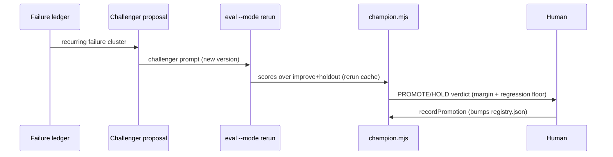

# Autopilot — Low-Level Design (LLD)

> Module-level design: data contracts, component inventory, the panel API, control-plane
> algorithms, and agent contracts. Companion to [HLD.md](HLD.md). Source of truth for
> schemas is [`../schemas.mjs`](../schemas.mjs); this doc summarises and explains it.

---

## 1. Repository layout

```
autopilot/
├── stage-graph.mjs           # THE pipeline graph: nodes, terminals, edges, projections
├── schemas.mjs               # zod contracts: Config, CostModel, Queue, Event (validates the graph)
├── config/
│   ├── config.json           # runtime knobs (gates, models, loop, escalation, …)
│   ├── queue.json            # unattended-sweep policy (jql, maxPerRun, mode, owner)
│   ├── repo-manifest.json    # repo/sub-package routing prior
│   ├── cost-model.json       # $/1M tokens per model + cache/output ratios
│   └── autopilot.env         # headless credentials (NPM_TOKEN, etc.)
├── scripts/                  # deterministic control plane (CLI + pure *-lib.mjs)
├── dashboard/
│   ├── server.mjs            # control panel HTTP server (:4317) + run spawner + ship gate
│   ├── ship-gate-lib.mjs     # pure gate decision (receipt vs worktree HEAD)
│   ├── ui/                   # React + TS + Tailwind + shadcn SPA (Vite)
│   ├── panel-dist/           # built SPA, gitignored — served with SPA fallback
│   ├── panel/*.js|css        # legacy no-framework pages (fallback when panel-dist absent)
│   ├── build-dashboard.mjs   # static cost/history generator → data.js
│   └── lib.mjs               # pure aggregation/pricing logic
├── .claude/
│   ├── agents/*.md           # subagent definitions (intake, router, preflight, coder, verifier)
│   └── skills/               # /resolve-ticket, /autopilot-queue orchestrators
├── tickets/<KEY>/            # per-ticket artifacts + telemetry (runtime state)
├── queue-runs/               # sweep logs, runs.jsonl, scans.jsonl + last-scan.json (scan state)
├── champion/registry.json    # Phase-3 versioned prompt registry
├── eval/                     # golden-set.json, eval-report.json, rerun-cache.json
├── tests/*.test.mjs          # vitest suite for every *-lib.mjs
└── docs/                     # HLD.md, LLD.md, SYSTEM-DESIGN.md
```

Worktrees live one level up in `acme/.wt/<KEY>-<repo>` (and `eval-<KEY>-<repo>` for eval reruns).

## 2. Data contracts (`schemas.mjs`)

All config/telemetry is validated by zod on load — malformed input is a clear early error.

### 2.1 Stage event — `tickets/<KEY>/events.jsonl` (append-only JSONL)

```jsonc
{ "event": "stage_end", "stage": "build", "agent": "coder-agent",
  "model": "sonnet", "status": "ok", "durationSec": 128,
  "tokensTotal": 191234, "cacheReadTokens": 40210, "notes": "…" }
```

- `stage ∈ {intake, route, preflight, context, plan, build, verify, review, ship}` (`STAGES`).
- `status ∈ {ok, fail, blocked, review, pending}`.
- `tokensTotal` = the subagent's real `subagent_tokens`; the dashboard splits it in/out via
  `cost-model.outputRatio`. `cacheReadTokens` is **additive** (not part of `tokensTotal`) and is
  priced at `cacheReadMultiplier`.
- `parseEventLine(line)` → `{ok:true, event}` or `{ok:false, reason}` (tolerant: skips blank/invalid lines).

### 2.2 Config — `config/config.json` (`ConfigSchema`)

Key fields: `gates` (`afterRoute`, `beforePR`, `merge:"human-only"`, …), `models` (per-stage
alias → `opus|sonnet|haiku`), `routeConfidenceThreshold`, `verifyMaxLoops`, `reviewRepairLoops`,
`baseBranch`, `worktreeDir`, `teardownWorktreesAfterShip`, and the phase sub-objects:
`loop`, `escalation`, `selfImprovement`, `critic`, `ux`, `followup`. `.passthrough()` keeps
unknown keys (e.g. `prSelfReview`, `scheduler`, `paused`).

- **`loop`** — `rubricTarget`, `budgetUsdPerTicket` (**null = no per-ticket cap**; when unset,
  `maxRepairRounds` and `stallRounds` are the only bounds on a repair loop, and
  `evaluateBudgetGate` stops holding over-cap tickets out of the build queue),
  `maxRepairRounds`, `stallRounds`,
  `rubricWeights{visualDiff,acCoverage,conventions,a11y}` (must sum to ~1 ±0.01).
- **`selfImprovement`** — `improveSetSize`, `holdoutSetSize`, `promotionMargin`,
  `minHoldoutCases`, `regressionFloor`.
- **`followup`** — `nudgeAfterDays ≤ escalateAfterDays` (enforced).

### 2.3 Cost model — `config/cost-model.json` (`CostModelSchema`)

`{ currency, cacheReadMultiplier(0.1), outputRatio(0.3), models{ <id>:{in,out} } }`, `_default` required.

### 2.4 Queue policy — `config/queue.json` (`QueueSchema`)

`jql`, `maxPerRun (≤20)`, `mode ∈ {dry-run, build-verify-notify, auto-draft-pr}`,
`skipIfBranchExists`, `notify`, `owner{accountId,displayName}`, `runLogDir`.

### 2.5 Per-ticket state — `tickets/<KEY>/status.json`

```jsonc
{ "key":"PROJ-2682", "lastCompleted":"review", "stage":"ship",
  "status":"shipped-pending-human-merge", "repos":[…], "branches":[…],
  "prs":[…], "rubricScore":0.993, "updatedAt":"…" }
```

Drives resume (`stage`/`lastCompleted`), the panel kanban column, and merge polling. `status`
may be `escalated-awaiting-human` (+ `escalation` reason) when a stage gated.

### 2.6 Other files

- `rubric.jsonl` — one line per repair round `{round, score, breakdown}`.
- `champion/registry.json` — `{champions:{<agent>:{version,ref,promotedAt}}, promotionLog:[]}`.
- `eval/golden-set.json` — `{tickets:[{key, pr, mergedCommit, repo, expect{…}}]}`.
- `eval/rerun-cache.json` — `{entries:{ "<key>::<baseSha>::<promptHash>": {score,pass,checks,…} }}`.
- `queue-runs/runs.jsonl` — `{ranAt, mode, outcomes:[{key, outcome, branch, pr}]}`.

## 3. Orchestrator — `/resolve-ticket`

CLI: `/resolve-ticket <KEY> [--dry-run] [--from <stage>] [--until <stage>] [--yes] [--auto-ship] [--repo <id>]`

- Resumes at `lastCompleted + 1` unless `--from` overrides; starts at INTAKE otherwise.
- `--dry-run` = INTAKE→ROUTE→PLAN only (read-only, no worktree). `--until <stage>` stops after
  that stage (e.g. `--until build` → no verify/review/ship, hence **no PR/Jira** — used by eval rerun).
- `--auto-ship` = rubric-gated PR tail: run through REVIEW, open the PR only if
  `rubricScore ≥ loop.rubricTarget`, else stop at review. `--yes` pre-approves the `beforePR` gate.
- Every stage is a **delegated subagent**; the orchestrator appends the `stage_end` event with
  real usage, and writes `status.json` after each stage.

## 4. Subagent roster (`.claude/agents/`)

| Agent | Model | Reads | Writes | Tools |
|---|---|---|---|---|
| `intake-agent` | haiku | Jira issue (+comments/parent/subtasks/links) | `ticket.md` | Read/Write/Grep/Glob |
| `router-agent` | opus→(sonnet) | manifest + code search | `route.md` | Read/Write/Grep/Glob/Bash |
| `preflight-agent` | sonnet | git history of routed files + ticket refs | `preflight.md` (verdict) | Read/Write/Bash/Grep/Glob |
| `coder-agent` | sonnet | `plan.md`, repo (worktree) | branch + commits | Read/Write/Edit/Grep/Glob/Bash |
| `verifier-agent` | sonnet | repo scripts | `verify.md` (pass/fail per gate) | Read/Write/Edit/Grep/Glob/Bash |
| `story-reviewer` | opus | PR diff vs ACs | findings (severity-tagged) | Read/Grep/Glob (read-only) |

Model aliases resolve via `config.models`; `opus=claude-opus-4-8`, `sonnet=claude-sonnet-5`,
`haiku=claude-haiku-4-5`.

## 5. Control panel — `dashboard/server.mjs`

HTTP server on `PORT=4317` (127.0.0.1). Static panel assets served fresh from disk (no build step).

### 5.1 API

| Method · Path | Purpose |
|---|---|
| `GET /api/state` | Kanban + runs + `automation` (cron, pending scan keys, pause). |
| `GET /api/cost` | Priced aggregate for the cost view. |
| `GET /api/config` · `POST /api/config` | Read / write validated `config.json`. |
| `GET /api/log?key=` · `GET /api/ticket?key=` | Run log / event timeline + artifacts. |
| `GET /api/stream` | SSE: `state`, `log`, `run-end` events. `run-end` carries `{key,mode,code,ok,status,failure}` — read `status`, **not** `code` (see §5.3). |
| `POST /api/run` `{key,mode,notes?}` | Spawn a headless run (mode ∈ PROMPTS ∪ `continue`). |
| `POST /api/cancel` `{key}` | SIGTERM the active run. |
| `POST /api/archive` / `unarchive` | Manual archive marker. |
| `POST /api/cron` `{enabled,intervalMinutes}` | Toggle the scheduled scan. |
| `POST /api/queue-run` | **Scan only** (`runScan()` → updates "N waiting"); does not start runs. |
| `POST /api/pause` `{paused}` | Global kill-switch (cancels active, blocks new). |
| `POST /api/check-merge` `{key}` | Poll GitHub for merge; on MERGED → archive. |

### 5.2 Run spawning

- `PROMPTS` maps a mode → a fixed `/resolve-ticket` invocation. The **only** value interpolated
  into argv is the regex-validated `<KEY>` (`/^PROJ-\d+$/`) — no free text reaches the command.
  - `plan` → `--until plan` · `build` → `--from build --auto-ship` · `review` → `--auto-ship`
    · `ship` → `--from ship --yes` · `replan` → `--from plan --until plan` · `continue` → resume from blocked stage.
- `startRun()` spawns `claude -p <prompt> --output-format stream-json --verbose --settings <headless>`
  in the workspace, streaming each event to SSE + the ticket log. Headless settings = a pre-scoped
  permission policy (headless runs can't show a prompt). `MAX_CONCURRENT_RUNS` caps parallelism.
  On exit the run is judged by the evidence rule in §5.3 — never by the exit code alone.
- `runScan()` runs `node scripts/jira.mjs search <jql>` and stores `lastScan.keys` — the "N waiting"
  list. The scheduled tick calls it every `scheduler.intervalMinutes` when enabled and not paused.

### 5.3 Run outcome — `dashboard/run-outcome-lib.mjs`

**The exit code is not the verdict.** When a slash command doesn't resolve — e.g. the workspace-root
skill symlinks at `acme/.claude/skills/` are dangling, so `/resolve-ticket` is not a command — the
CLI emits a synthetic `Unknown command: …` assistant message and a `result` event with
`subtype: "success"`, `is_error: false`, `num_turns: 0`, `total_cost_usd: 0`, then **exits 0**. A real
incident had three such runs logged as `✓ success · $0.00`. `is_error` alone does not catch this.

The verdict is therefore evidence of *work*, computed by `classifyRunOutcome()`:

> A run did work iff it appended a **`stage_end`** event to the ticket's `events.jsonl`,
> or the SDK's own `result` event reports a **nonzero `total_cost_usd`**. Neither → no-op → failed.

- Precedence: operator cancel → CLI hard error (`Unknown command:` / `Skill not found` / `Unknown
  agent type`, matched only against CLI-generated text, never model prose) → `is_error` → non-zero
  exit → the no-op test above.
- `startRun()` samples the `stage_end` count **before** spawning so the delta is this run's own; the
  ad-hoc PR-review path has no `events.jsonl` and passes no counter, so a null delta means *unknown*
  (cost decides alone) rather than zero.
- A deliberate cancel is `status: 'cancelled'`, not `failed` — SIGTERM yields exit code `null`→0 and
  zero cost, which is shape-identical to a no-op, so `/api/cancel` and `/api/pause` flag intent first.
- The verdict is emitted three ways: a `✗ run <mode> FAILED — <why>` line through the normal log+SSE
  path, the log trailer `=== run-end <mode> code=0 status=failed ===`, and `run-end`'s `ok`/`status`/
  `failure`. `formatCost` renders a sub-cent cost at 4dp so a real-but-cheap run never prints the
  `$0.00` that means "nothing ran".

## 6. Cost aggregation — `dashboard/lib.mjs`

- `splitTokens(ev, cm)` — if only `tokensTotal`, split into in/out by `outputRatio`.
- `priceEvent(ev, cm)` — `in·rate_in + out·rate_out + cacheReadTokens·rate_in·cacheReadMultiplier`;
  honours an explicit `costUsd` if present.
- `buildTicket(key, summary, events, cm)` — per-stage rows + ticket totals (cost, tokens,
  `tokensIn`, `cacheReadTokens`, duration), sorted into pipeline order.
- `aggregate(tickets, …)` — totals + `costByStage`/`tokByStage` + **`cacheHitRate`**
  (`cacheReadTokens / (cacheReadTokens + inputTokens)`, `null` until any cache token is recorded).
- `build-dashboard.mjs` scans `tickets/*/events.jsonl`, validates via `parseEventLine`, and writes
  `data.js` consumed by `index.html`.

## 7. Control-plane algorithms (`scripts/`)

Each has pure logic in `*-lib.mjs` (unit-tested) and a thin IO/CLI wrapper.

- **`rubric-lib.scoreRubric`** — weighted score of `{visualDiffPassRate, acCoveredRatio,
  conventionViolations, a11yFailures, codeQualityScore}`; **conventions & a11y are binary-gated**
  (any violation → 0 for that dimension) so a "mostly clean" diff can't average past the bar,
  while `codeQuality` stays fuzzy. A dimension may be **excluded** (not applicable — weight
  dropped, remainder renormalized) or **unmeasured** (the check could not run). Both leave the
  arithmetic; only the first may end in a pass. Naming a dimension in both resolves to unmeasured,
  so an infrastructure failure cannot be laundered into a clean exclusion.
- **`rubric-lib.resolveVisualDiff`** — a claimed pass rate is honoured only when recomputed from a
  real `visual-diff.mjs` report. A `visualDiffSkipReason` *excludes* the dimension rather than
  paying out a 1.0, and is **refused outright** when the ticket enumerated variant nodes, because
  then a diff was possible. CONTEXT's `design-links.json` is the authority on that and answers in
  both directions - `variantNodes: []` or `enumerationBlocked` + `blockedReason` is a real "no".
  Without the file, `design.md` prose is scanned for node ids as a fallback that can only say yes:
  it reads a ruled-out node the same as a real variant, which refused a truthful skip on
  PROJ-3749. A malformed file, or a blocked claim with no reason, falls back to the prose scan -
  absence is never permissive.
- **`loop.mjs`** (Phase 1) — turns a rubric snapshot + priced spend into a single
  `done | continue | stop-*` verdict: rubric target, per-ticket budget cap, a stall detector, and
  `stop-unverified` when anything was unmeasured (which outranks the budget and round caps). It is
  the **only writer** of `rubric.jsonl` and of `status.json`'s `rubricScore`, stamping each receipt
  with the worktree HEAD sha it scored. It recomputes `conventionViolations` itself and discards
  any value supplied in `rubric-inputs.json`.
- **`conventions-lint.mjs`** — the mechanically decidable half of `conventions.md` (raw hex, Figma
  citations in comments, TODOs, over-long comment blocks, flat structure, tool branding, branch
  shape). Consumed by `loop.mjs`, `coder-agent` (pre-commit self-check) and the eval harness.
- **`story-capture.mjs`** — Playwright over a static Storybook build; captures each variant × theme
  and emits a `visual-diff.mjs` manifest containing only pairs that exist on both sides. Partial
  coverage exits non-zero on purpose. This is the mechanism whose absence made the visual gate
  unrunnable for 25 tickets.
- **`regression-trace.mjs`** — the escaped-defect rate, plus its correlation against the rubric.
- **`validate-graph.mjs`** — audits each ticket's recorded stage path against `stage-graph.mjs`'s
  edge set, naming the offending hop and the legal alternatives. Exits non-zero, so it can gate CI.
- **`critic-lib`** (Phase 4) — triages Builder/Critic objections into blocking vs. minor and
  fingerprints repeated objections to stop a stuck critic; bounded by `critic.maxRounds`.
- **`stakes-lib`** — classifies a change's stakes; `escalation.highStakesRequiresHuman` blocks
  auto-ship on HIGH.
- **`guard.mjs`** — `withGuard(label, fn, opts)` wraps risky IO/network with classify + retry +
  structured acknowledgement; `{ok, value}` / `{ok:false, kind, message}`.
- **`eval.mjs` / `eval-lib` / `eval-rerun-lib`** — golden-set regression:
  - `--mode diff` scores a provided diff via `scoreDiff` (fileOverlap, mustContain,
    noRawHexInComponents, testCountDelta; pass ≥ 0.8).
  - `--mode rerun` runs a real BUILD (`--until build`) in a throwaway worktree at the
    **parent of `mergedCommit`**, captures `git diff`, and scores it. A **rerun cache** keyed
    `key::baseSha::promptHash` (prompt hash = SKILL + conventions + manifest + config +
    champion-registry agent prompts) skips the build when nothing that affects it changed;
    `--no-cache`/`--dry-run` bypass. `EVAL_BUILD_CMD` mocks the build for tests.
- **`champion.mjs` / `champion-lib`** (Phase 3) — deterministic improve/holdout split; a
  challenger is **PROMOTE**d only if it beats the champion on the holdout by `promotionMargin`
  and no case regresses below `regressionFloor` (min `minHoldoutCases`). Emits a verdict;
  `recordPromotion` (human-run) bumps `champion/registry.json`.
- **`escalation-lib` / `followup(-lib)` / `pr-feedback(-lib)` / `ux-lib` / `visual-diff(-lib)`** —
  hand-back-to-human, stale-PR nudges/escalations, human PR-comment loop, UX-flow rubric, and
  pixel visual-diff (pixelmatch) respectively.
- **`worktree.mjs`** — `create|remove|list` via simple-git; guarded fetch, degrade to local base.
- **`jira.mjs`** — headless Jira wrapper (`get|comment|transitions|transition|search|whoami|create-subtask`).
- **`validate-config.mjs`** — runs all schemas over `config/*` (`npm run validate`).

## 8. Key sequences

### 8.1 Resolve one ticket

```mermaid
sequenceDiagram
  participant U as User/Panel
  participant O as Orchestrator
  participant W as Worktree
  participant Jira
  participant GH as GitHub
  U->>O: /resolve-ticket KEY [--auto-ship]
  O->>Jira: fetch issue (intake)
  O->>O: route → preflight → context → plan (gates)
  O->>W: create worktree, coder builds
  O->>W: verify (loop fixer on red)
  O->>O: review + repair; score rubric
  alt rubric ≥ target
    O->>GH: push branch, open ready-for-review PR
    O->>Jira: owner-tagged audit comment + transition
  else below target / high stakes
    O->>Jira: escalation comment; write escalation.json; PAUSE
  end
  Note over O: never merges — human gate
```

### 8.2 Self-improvement (human-gated)



## 9. Testing & validation

- `npm test` (vitest) covers every `*-lib.mjs` (pure logic) — 455 tests.
- `node scripts/validate-graph.mjs` audits recorded stage paths against the declared edge set.
- `npm run validate` runs the zod schemas over `config/*`.
- `eval --mode diff` is the CI-friendly regression gate; `--mode rerun` measures prompt changes
  end-to-end (spends tokens; cache-guarded).

## 10. Extension points

- **New repo** → add to `config/repo-manifest.json` (routeKeywords, sub-packages, verify commands).
- **New pipeline stage** → add the node **and its edges** to `stage-graph.mjs`; the schema enum, the resumable set and the board columns all derive from it. Then the orchestrator, and the
  panel stepper; kanban folds unlisted stages onto a neighbour via `foldStage`.
- **New agent prompt version** → add to `champion/registry.json`; validate via the eval + champion gate.
- **New cost/telemetry field** → extend `EventSchema` + `priceEvent`/`aggregate`; the dashboard picks it up.

---

*Companion: [HLD.md](HLD.md) · original rationale: [SYSTEM-DESIGN.md](SYSTEM-DESIGN.md).*
