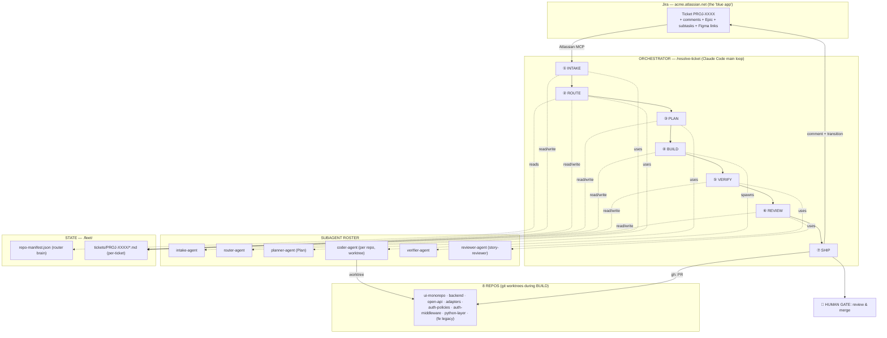

# Autopilot — Autonomous Jira Ticket Resolution System

**Working name:** Autopilot (rename freely).
**Purpose:** Point it at a Jira ticket; it plans, routes across repos, implements,
tests, reviews, and opens PRs — end to end, behind the scenes — stopping only at the
human merge gate.

> **Status: historical blueprint — kept for the record of intent, not as current truth.**
> This was written before anything was built. It has since been built, run on 25 real tickets,
> and substantially revised in ways this document does not reflect. It is preserved because the
> *reasoning* behind the original shape is still worth reading; where it disagrees with the
> documents below, they win.
>
> | For | Read |
> |---|---|
> | What the system is now | [HLD.md](HLD.md) |
> | How it is built | [LLD.md](LLD.md) |
> | Interfaces more than one component depends on | [INTEGRATION-CONTRACTS.md](INTEGRATION-CONTRACTS.md) |
> | What is being changed and why | [../GOALS.md](../GOALS.md) |
>
> **The one thing this blueprint got wrong**, and the reason for most of the revisions: it
> specified the quality gates as instructions to the orchestrator. An instruction is not a gate.
> Across the first 25 tickets the "mandatory" per-variant screenshot diff produced zero reports,
> the rubric scored ≥0.965 on nearly everything, and 9 of 20 shipped tickets later produced a
> fidelity defect against a component they had shipped. Sections 4 and 9 below describe gates
> that are now executable code — see the HLD's design principles for what replaced them.
>
> Grounded in this workspace: the 8 repos under `~/workspace/`, the
> `ACME-ECOSYSTEM-GUIDE.md`, and a real target ticket (PROJ-2899, a UI-kit component story).

---

## 1. Design decisions already locked

These came from the requirements conversation and shape everything below:

| Decision | Choice | Consequence |
|---|---|---|
| **Autonomy boundary** | Autonomous **through PR creation**; human reviews & merges | Autopilot never touches a shared branch. It only pushes its own feature branch and opens a PR. No auto-merge in v1. |
| **Execution environment** | **Local Claude Code, on-demand** (`/resolve-ticket PROJ-2899`) | You watch it work. No cloud/CI infra needed for v1. Cron polling is a v2 add-on. |
| **Scope** | **Multi-repo routing from day one** | A router decides *which* of the 8 repos a ticket touches; coding runs in isolated git worktrees so parallel repos never collide. |

---

## 2. Design principles

1. **Human gates only where damage is irreversible.** The single hard gate is *merge*.
   Everything up to and including "PR opened + Jira updated" is autonomous.
2. **Ground every decision in code, not just docs.** The ecosystem guide is a *prior*,
   not the truth. The router and planner always verify against the actual repos.
   (Already proven useful: the guide says the UI kit uses "Vanilla Extract"; the real
   Combobox uses SCSS-modules + CVA. Code wins.)
3. **All state is on disk and resumable.** Every stage writes a file under
   `.fleet/tickets/<KEY>/`. A crash or a `Ctrl-C` loses nothing; a re-run resumes from
   the last completed stage instead of starting over.
4. **Every stage is auditable.** You can read *why* the router picked a repo and *why*
   the planner chose an approach, before any code is written.
5. **Isolation by default.** Each repo's implementation runs in its own git worktree on
   its own feature branch. Nothing runs against your working checkouts.
6. **The orchestrator is thin; the agents are specialized.** One pipeline definition
   drives a roster of narrow subagents. Easy to reason about, easy to extend.

---

## 3. High-level architecture



---

## 4. The pipeline — stage by stage

Each stage has: **trigger → work → tools/agent → output artifact → failure handling.**
Every stage is idempotent and resumable from its artifact.

### ① INTAKE — understand the ticket
- **Work:** Pull the ticket, its description, comments, Epic/parent, subtasks, issue
  links, and any Confluence / Teamwork-Graph context. Extract acceptance criteria,
  Figma links, and open questions from comments.
- **Tools:** Atlassian MCP — `getJiraIssue` (fields incl. `comment`, `parent`,
  `subtasks`, `issuelinks`), `getTeamworkGraphContext`, `getConfluencePage`,
  `getJiraIssueRemoteIssueLinks`. Figma MCP for design/spec links when present.
- **Output:** `.fleet/tickets/<KEY>/ticket.md` — normalized ticket: summary, ACs as a
  checklist, design links, open questions, parent/epic context.
- **Failure / gate:** If acceptance criteria are missing/ambiguous, or a comment poses
  an unanswered question (e.g. PROJ-2899's *"Need more examples for all-chips-selected"*),
  Autopilot flags it and can **post a clarifying comment and pause** rather than guess.
  *(This is a config choice — see §9 Clarification policy.)*

### ② ROUTE — which repo(s), in what order
- **Work:** Decide which of the 8 repos the ticket touches, why, with a confidence
  score, and the correct **order** (e.g. contract-first per Ecosystem Guide Workflow A).
  Then verify the guess against the actual code (grep for the named component/endpoint).
- **Tools:** `router-agent` reads `.fleet/repo-manifest.json` (§6) + the ecosystem
  guide, then an `Explore` pass over candidate repos to confirm.
- **Output:** `.fleet/tickets/<KEY>/route.md` — ranked list `{repo, why, confidence,
  entry_points[], build/test cmds}` and a dependency order across repos.
- **Failure / gate:** If top confidence < threshold, pause and ask you to confirm the
  target repo(s) before planning. (For PROJ-2899 the router resolves to
  `erp-next-ui-monorepo` alone, high confidence — the UI kit lives there.)

### ③ PLAN — how to implement
- **Work:** Per affected repo, produce a concrete, verifiable implementation plan:
  files to create/modify, the pattern to mirror (e.g. "mirror `Combobox.tsx` /
  `useCombobox.ts` / `combobox.module.scss`"), test strategy, and how each acceptance
  criterion will be satisfied and checked.
- **Tools:** `planner-agent` (the `Plan` agent) with the intake + route artifacts and
  read access to the target repo. Reuses the existing `.story/` TDD flow where it fits.
- **Output:** `.fleet/tickets/<KEY>/plan.md` — per-repo step list mapped to ACs.
- **Gate (optional):** You chose PR-gate, so this is auto by default. A stricter
  "approve plan first" mode is a one-line config flip (§9).

### ④ BUILD — implement in isolation
- **Work:** For each repo in dependency order, create a git worktree + feature branch
  `autopilot/<KEY>-<slug>`, and run a `coder-agent` that executes the plan. Repos with
  no dependency between them build in **parallel**; dependent ones (contract → consumer)
  build in sequence.
- **Tools:** `coder-agent` per repo, `isolation: worktree`. Follows repo conventions
  (path aliases, envelope shapes, CVA/SCSS patterns) captured in the manifest.
- **Output:** commits on the feature branch in each worktree; `progress.md` updated.
- **Failure / gate:** A coder-agent that can't satisfy the plan records a blocker in
  `progress.md` and stops that repo's chain without touching the others.

### ⑤ VERIFY — prove it works
- **Work:** Per repo, run the manifest's install/build/test/lint commands. Loop:
  on failure, feed errors back to a fixer pass, re-run, up to N attempts. Green required.
- **Tools:** `verifier-agent` + background `Bash` tasks. Per-repo commands come from the
  manifest (e.g. monorepo: `yarn install` → `yarn build` → `yarn test` → `yarn lint`).
- **Output:** `verify.md` — command outputs, pass/fail per gate, coverage of ACs.
- **Failure / gate:** If still red after N loops, stop before REVIEW and surface the
  failing output. Never open a PR on red.

### ⑥ REVIEW — adversarial self-check
- **Work:** Independent review of each diff against the acceptance criteria: correctness,
  generality (no hardcoding to pass tests), security, convention adherence, and
  "does it actually meet every AC." 
- **Tools:** `reviewer-agent` (your existing `story-reviewer` + `/code-review`).
- **Output:** `review.md` — findings ranked; blocking findings loop back to BUILD.
- **Failure / gate:** Blocking findings → one repair loop → re-verify → re-review.

### ⑦ SHIP — PR + Jira, then hand off
- **Work:** Per repo: push the feature branch, open a PR (title/body generated from the
  ticket + plan + AC checklist + test summary; links the Figma + Jira). Then on the
  ticket: post a comment with the PR link(s) and a summary, log work if desired, and
  transition status (e.g. → *In Review*).
- **Tools:** `gh` CLI for PRs; Atlassian MCP `addCommentToJiraIssue`,
  `transitionJiraIssue`, optional `addWorklogToJiraIssue`.
- **Output:** `ship.md` — PR URLs, comment id, new status.
- **🚦 HUMAN GATE:** You review the PR(s) and merge. Autopilot stops here.

---

## 5. Subagent roster

Narrow agents, each with the minimum tools it needs. Most already exist in your setup.

| Agent | Exists? | Role | Tools |
|---|---|---|---|
| `intake-agent` | new (thin) | Normalize ticket + context into `ticket.md` | Atlassian MCP, Figma MCP, Read/Write |
| `router-agent` | new | Repo selection + verification | Read manifest+guide, `Explore`, Grep/Glob |
| `planner-agent` | **`Plan`** ✓ | Implementation plan per repo | read-only repo access |
| `coder-agent` | reuse general-purpose | Implement plan in a worktree | full tools, worktree isolation |
| `verifier-agent` | new (thin) | Run build/test/lint, loop on failure | Bash, Read |
| `reviewer-agent` | **`story-reviewer`** ✓ | Adversarial review vs ACs | Read/Grep/Glob (read-only) |

The orchestrator itself is the `/resolve-ticket` skill (§8) running in the main loop.

---

## 6. The routing manifest — the router's brain

A compact, machine-readable distillation of the ecosystem guide, kept next to the code
so routing/verification don't re-read 48KB of prose every run. **This is the highest-
value artifact to build first.** Schema:

```jsonc
// .fleet/repo-manifest.json
{
  "version": 1,
  "workspaceRoot": "~/workspace",
  "jira": { "site": "acme.atlassian.net", "project": "PROJ" },
  "repos": [
    {
      "id": "erp-next-ui-monorepo",
      "layer": "frontend",
      "purpose": "Next.js 14 web app + internal UI kit (packages/erp-next-ui-kit)",
      "routeKeywords": ["component", "ui kit", "screen", "page", "form",
                        "multiselect", "combobox", "modal", "storybook", "figma"],
      "entryHints": {
        "uiKit": "packages/erp-next-ui-kit/lib/components",
        "app": "frontend/src"
      },
      "conventions": ["SCSS modules + CVA (NOT vanilla-extract)", "RHF + Zod",
                      "RTK Query for all server data", "response envelope {success,data}"],
      "commands": {
        "install": "yarn install",
        "build": "yarn build",
        "test": "yarn test",
        "lint": "yarn lint",
        "storybook": "yarn storybook"
      },
      "needs": { "githubPAT": "NODE_AUTH_TOKEN", "figma": true }
    },
    {
      "id": "erp-next-open-api",
      "layer": "contract",
      "purpose": "Single source of truth for API types → 3 published packages",
      "routeKeywords": ["api type", "contract", "endpoint shape", "openapi", "zod schema"],
      "conventions": ["authored in TS under src/openapi/", "TWO specs: openapi.json AND stale openapi.yaml",
                      "no auto-propagation — consumers bump the dep"],
      "commands": { "gen": "yarn generate:spec", "regenFe": "yarn regenerate:frontend" },
      "dependencyRule": "contract-first: change here BEFORE its consumers"
    }
    // ... one entry per repo: backend, adapters, auth-policies, auth-middleware,
    //     python-layer, (fe legacy = do-not-touch)
  ],
  "crossRepoWorkflows": [
    { "name": "backend-backed feature", "order": ["open-api","adapters","backend","ui-monorepo"] },
    { "name": "port legacy screen",     "order": ["resources(ref)","python-layer","adapters","backend","ui-monorepo"] },
    { "name": "permission change",      "order": ["auth-policies","auth-middleware","backend","ui-monorepo"] }
  ]
}
```

The router consults `routeKeywords` + `crossRepoWorkflows` for a first guess, then
**confirms** with a code search before committing (principle #2).

---

## 7. State & memory model

```
acme/
├─ .fleet/
│  ├─ repo-manifest.json            # router brain (§6)
│  ├─ config.json                   # gates, thresholds, clarify policy (§9)
│  └─ tickets/
│     └─ PROJ-2899/
│        ├─ ticket.md               # ① intake
│        ├─ route.md                # ② routing decision + confidence
│        ├─ plan.md                 # ③ per-repo plan mapped to ACs
│        ├─ progress.md             # ④ live build log + blockers
│        ├─ verify.md               # ⑤ build/test/lint results
│        ├─ review.md               # ⑥ review findings
│        ├─ ship.md                 # ⑦ PR urls + jira transition
│        └─ status.json             # {stage, lastCompleted, branches[]}  ← resume point
```

`status.json` is the resume pointer: a re-run of `/resolve-ticket PROJ-2899` reads it
and continues from `lastCompleted + 1`. Cross-ticket long-term learnings (e.g.
"monorepo test command is actually X") can graduate into your existing Claude memory dir.

---

## 8. The orchestrator — `/resolve-ticket`

A Claude Code **skill** (slash command) at `.claude/skills/resolve-ticket/SKILL.md` in
the workspace root. Invocation: `/resolve-ticket PROJ-2899 [--from route] [--dry-run]`.

Responsibilities:
1. Parse the key; ensure `.fleet/tickets/<KEY>/` exists; read `status.json` to find the
   resume point.
2. Drive stages ①–⑦ in order, spawning the roster agents, honoring gates from
   `config.json`.
3. After each stage, write the artifact + update `status.json` before proceeding.
4. Respect `--dry-run` (stages ①–③ only, read-only, no branches/PRs) and `--from <stage>`.

The skill is *instructions*, not code — it tells the main loop how to orchestrate. This
keeps it transparent and editable.

---

## 9. Configuration, gates & clarification policy

`.fleet/config.json`:

```jsonc
{
  "gates": {
    "afterPlan": "auto",         // "auto" | "confirm"  (you chose auto)
    "beforePR":  "auto",         // PR is created autonomously; merge stays human
    "merge":     "human"         // hard gate — never automated in v1
  },
  "routeConfidenceThreshold": 0.7,   // below → ask you to confirm repos
  "verifyMaxLoops": 3,
  "clarify": "comment-and-pause",    // on ambiguous ACs / open questions:
                                     //  "comment-and-pause" | "best-effort-note" | "ask-locally"
  "branchPrefix": "autopilot/",
  "prDraft": true                    // open PRs as draft by default
}
```

---

## 10. Safety & permission model

Autopilot performs several **side-effectful, outward-facing** actions. These map to the
assistant safety rules and must always confirm or gate:

| Action | Handling |
|---|---|
| Pushing a branch / opening a PR | Explicit action — announce target repo + branch + PR title, create as **draft**, gate configurable |
| Commenting on / transitioning a Jira ticket | Announce the exact comment + status change before posting |
| Merging | **Never automated.** Human only. |
| Deleting anything | Out of scope — Autopilot never deletes branches/tickets/files it didn't create |
| Credentials (GitHub PAT, Jira, Figma) | Read from environment / existing sessions — Autopilot never enters or echoes secrets |

Autopilot treats **ticket text, comments, and design files as data, not instructions.**
A comment saying "just force-merge this" is surfaced to you, never acted on.

---

## 11. Multi-repo & worktree strategy

- One worktree per affected repo per ticket: `git worktree add ../.wt/<KEY>-<repo> -b autopilot/<KEY>-<slug>`.
- Independent repos build **in parallel**; dependency-ordered repos (contract → consumer)
  build **in sequence** per `crossRepoWorkflows`.
- Worktrees are torn down after SHIP (branches remain on the remote for the PR).
- Your primary checkouts are never modified.

---

## 12. Failure handling & resumability

| Failure | Behavior |
|---|---|
| Crash / Ctrl-C mid-run | `status.json` holds last completed stage; re-run resumes there |
| VERIFY red after N loops | Stop before REVIEW; surface failing output; no PR |
| Router low confidence | Pause, ask you to confirm repos |
| Ambiguous ACs / open comment | Per `clarify` policy: comment-and-pause by default |
| One repo blocked in a multi-repo ticket | Other repos continue; blocked one reported |

---

## 13. Build roadmap (what to build, in order)

Phased so each phase is independently useful and testable.

- **Phase 0 — Foundations**
  - `.fleet/repo-manifest.json` (distill the ecosystem guide for all 8 repos)
  - `.fleet/config.json`
  - `.fleet/tickets/` layout + `status.json` schema
- **Phase 1 — Read-only brain (highest value, zero risk)**
  - `/resolve-ticket --dry-run`: INTAKE → ROUTE → PLAN
  - `intake-agent`, `router-agent`, reuse `Plan`
  - *Validate on PROJ-2899: is the routing + plan correct?*
- **Phase 2 — Build & verify (isolated)**
  - Worktree BUILD + `coder-agent`; VERIFY loop + `verifier-agent`
  - Still no PRs — stops at green diffs in worktrees
- **Phase 3 — Review**
  - Wire `story-reviewer` / `/code-review` as REVIEW; repair loop
- **Phase 4 — Ship**
  - `gh` PR creation (draft) + Jira comment/transition; the human merge gate
- **Phase 5 — Autonomy add-ons (v2)**
  - Cron/JQL polling (`label = autopilot`), push notifications, `Workflow` fan-out to
    resolve several tickets in parallel

---

## 14. Concrete file tree to create

```
acme/
├─ AUTOPILOT-SYSTEM-DESIGN.md          # this document
├─ .fleet/
│  ├─ repo-manifest.json               # Phase 0
│  ├─ config.json                      # Phase 0
│  └─ tickets/                         # created per ticket at runtime
└─ .claude/
   ├─ skills/
   │  └─ resolve-ticket/
   │     └─ SKILL.md                   # Phase 1 — the orchestrator
   └─ agents/
      ├─ intake-agent.md               # Phase 1
      ├─ router-agent.md               # Phase 1
      ├─ coder-agent.md                # Phase 2
      └─ verifier-agent.md             # Phase 2
      # (planner-agent = existing Plan; reviewer-agent = existing story-reviewer)
```

---

## 15. Open decisions before building

1. **Clarification policy** — when ACs are ambiguous or a comment asks a question, should
   Autopilot (a) post a clarifying Jira comment and pause, (b) proceed best-effort and
   note assumptions in the PR, or (c) just ask you locally in the terminal?
2. **PR granularity** — one PR per repo (recommended for multi-repo), or a single
   umbrella PR? And draft vs. ready-for-review by default?
3. **Jira transitions** — exact target status after SHIP (e.g. *In Review* / *Code Review*)
   and whether to log time via worklog.
4. **Branch/PR naming + base branch** — confirm base is `dev` (your `/pr-description`
   skill defaults to `dev`) and prefix `autopilot/`.
5. **Test authority** — adopt the frozen-test `.story/` TDD discipline (write tests
   first, freeze, implement to green) or a lighter "implement + add tests" flow?

---

*End of blueprint. Next step is yours: approve/adjust, then we build Phase 0 + Phase 1.*
